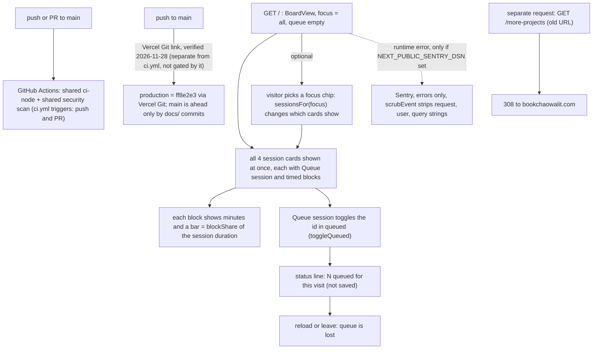
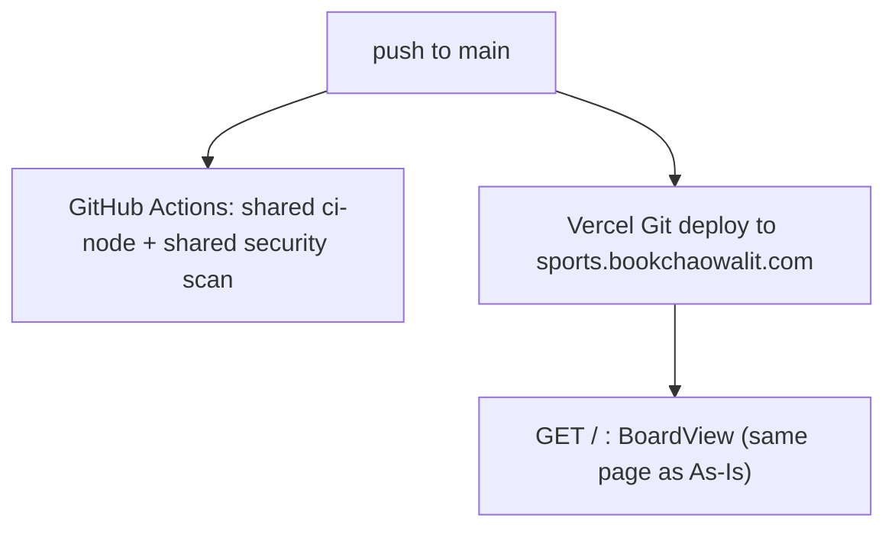

# 01 — Business process (As-Is / To-Be)

education-sports-web คือหน้าเว็บฝั่ง browser ล้วน (sports.bookchaowalit.com) แสดงตัวอย่างโปรแกรมฝึก 4 แบบ แบ่งเป็นบล็อกตามเวลา ให้กรองตามโฟกัสและกด queue ไว้ดูในรอบการเยี่ยมชมเดียว

Last reviewed: 2026-11-28 · commit `ff8e2e3`

## As-Is (จากโค้ดวันนี้)

Sources: `app/page.tsx`, `components/board-view.tsx`, `lib/sports.ts`, `lib/sentry.ts`, `next.config.ts`, `PRODUCT.md`

ข้อเท็จจริงจากโค้ด: ไม่มี network call ของตัวเอง ไม่เก็บข้อมูล (ยกเว้นรายงานข้อผิดพลาดไป Sentry); ปุ่ม More projects ใน footer ลิงก์ตรงไป bookchaowalit.com ไม่ผ่าน `/more-projects`. `components/board-view.tsx` แสดงทุก session ที่ผ่านตัวกรองเป็นการ์ด และไม่เรียก `pickSelected` ต่างจาก PRODUCT.md ที่เล่าว่า "เปิด session ที่เลือก". production = ff8e2e3 ผ่าน Vercel Git (ตรวจ 2026-11-28); main HEAD bc61860 นำหน้าเฉพาะ commit ใน docs/.

## To-Be (PRODUCT.md §Live URL and deploy state)

Sources: `PRODUCT.md` (owner action D9 done, verified 2026-11-28 via Vercel API)

## Gap

| ID | As-Is → To-Be | Status | Owner | Evidence |
|---|---|---|---|---|
| G1 | Vercel ไม่มี Git link, deploy ด้วย CLI เท่านั้น → push to `main` deploy เอง | done | owner | `PRODUCT.md` §Live URL and deploy state (owner action D9); Vercel API 2026-11-28: project `bookchaowalit-sports-frontend` Git link → `bookchaowalit-website/education-sports-web`, production branch `main` |
| G2 | PRODUCT.md บอกว่าเปิด session ที่เลือก (open session) แต่โค้ดแสดงทุกการ์ด → แก้เอกสารให้ตรงโค้ด | todo | claude | `components/board-view.tsx`; `lib/sports.ts` `pickSelected` ไม่ถูกเรียกจากหน้า |

## Open questions

- ไม่มีคำถามค้างเรื่อง deploy: production = ff8e2e3 via Vercel Git; main HEAD bc61860 is ahead only by docs/ commits (ตรวจกับ Vercel API 2026-11-28)
